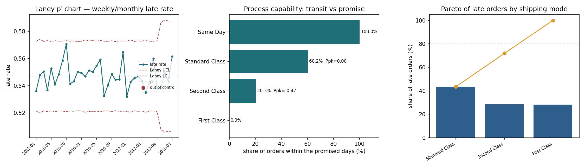
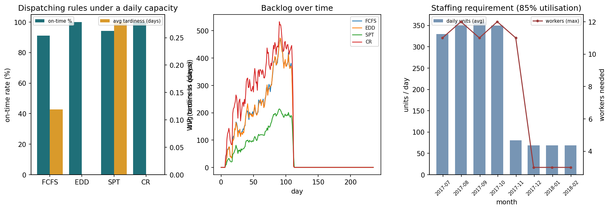
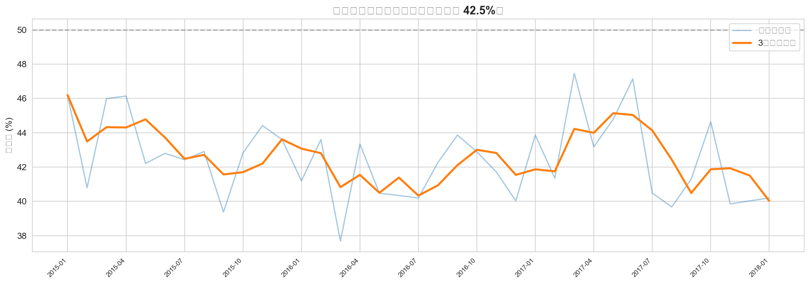
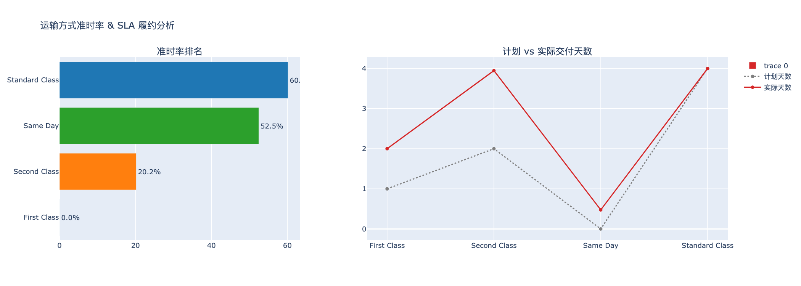
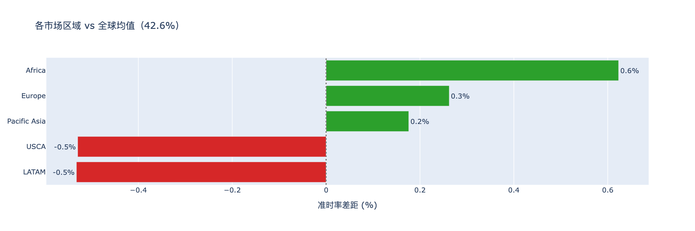
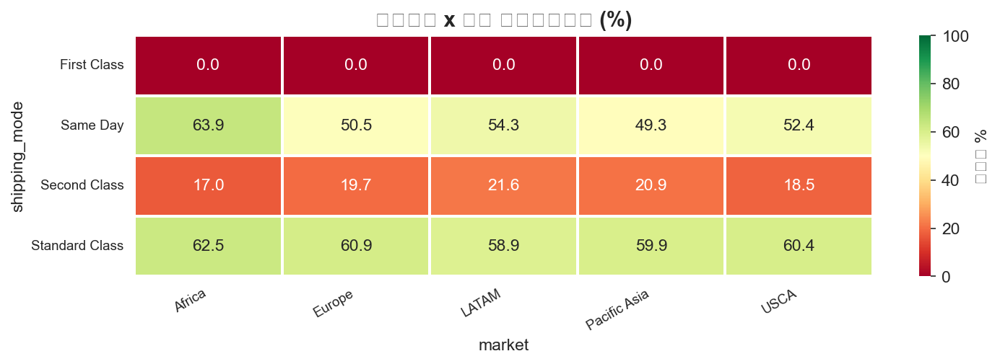
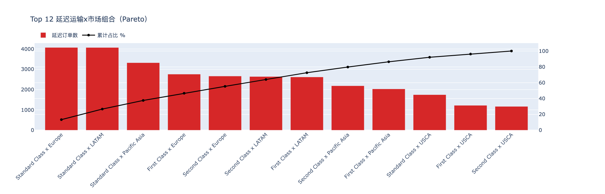
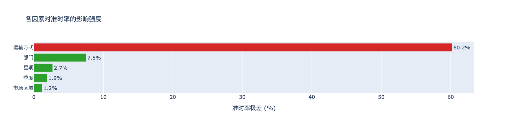
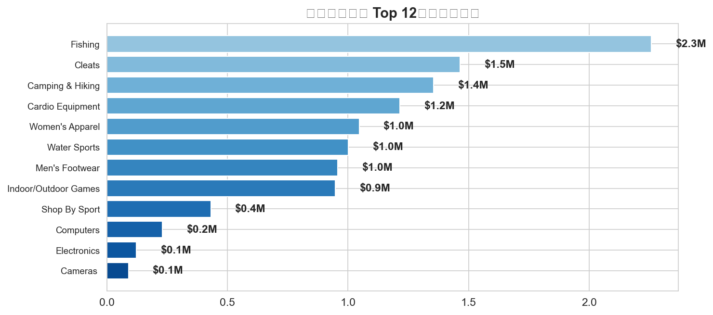
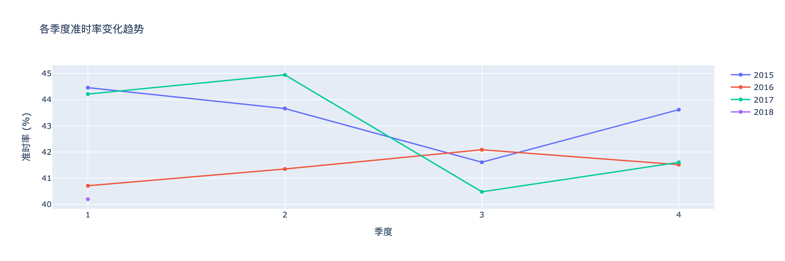

# 供应链运营分析平台

[](https://www.python.org/)
[](https://www.sqlite.org/)
[](https://streamlit.io/)
[](LICENSE) [](https://github.com/lingtao-meng/supply-chain-operations-analytics/actions/workflows/ci.yml)

用 DataCo 全球供应链数据集（180K+ 订单，53 个字段）做的运营分析项目。从数据清洗、星型建模、SQL 查询到 Streamlit 仪表板，整套流程都覆盖了。

---

## 做了什么

数据清洗后用 SQLite 搭了一个星型模型（5 张维度表 + 1 张事实表），写了 10 条分析查询，最后用 Streamlit + Plotly 做了一个 5 页的交互仪表板。

仪表板跑起来之后能看出来一些有意思的东西。比如 First Class 这个运输方式，SLA 承诺 1 天送达，但实际上平均要 2 天，准时率是 0%——不是说它慢，是它的承诺不现实。Second Class 也好不到哪去，承诺 2 天，实际平均 3.9 天。Standard Class 反而是最靠谱的，说 4 天就 4 天，准时率 60%。

超一半的延迟集中在 1-3 天，属于轻微延迟，不是大问题但量大，流程上优化一下应该见效很快。

**五个市场的准时率全部落在 42.0%–43.2% 之间**（LATAM 42.0%、USCA 42.0%、Pacific Asia 42.7%、Europe 42.8%、Africa 43.2%），最大差距只有 1.2 个百分点。这是个比"某区域物流差"更重要的结论：**延迟是系统性的，不是区域性的——问题出在承诺参数（SLA）而不是某个市场的运输能力**。想靠"加强 LATAM 物流"解决 58% 的延迟，方向就错了。

仪表板上有自动生成的文字洞察，会根据你选的筛选条件变化。比如只选某个年份和某个市场，它会告诉你这个范围内哪个运输方式最好、延迟集中在哪里、大概多少收入在风险敞口里。

---

## 项目结构

`app/app.py` — Streamlit 仪表板  
`python/` — 数据清洗和入库脚本  
`sql/` — 建表 DDL 和 10 条分析查询  
`notebooks/` — Jupyter 深度分析  
`tests/` — SQL 查询验证  
`images/` — 仪表板截图  
`setup.sh` — 一键初始化

---

## 怎么跑

```bash
git clone https://github.com/lingtao-meng/supply-chain-operations-analytics.git
cd supply-chain-operations-analytics

pip install -r requirements.txt

# 先跑数据清洗（需要先下载 DataCo 数据集，改一下 INPUT_PATH）
python python/01_data_cleaning.py
python python/02_load_to_db.py

# 启动仪表板
streamlit run app/app.py

# 或者一步到位
bash setup.sh && streamlit run app/app.py
```

数据集从 Kaggle 下载：[DataCo Supply Chain Dataset](https://www.kaggle.com/datasets/evilspirit05/datasupplychain)（93MB，180,519 条记录）。

如果本地已经有这个数据集，App 启动时会自动找到它，不需要手动跑清洗脚本。

---

## SQL 分析

10 条查询放在 `sql/02_analytics_queries.sql`，主要用到的写法：

- 窗口函数：滚动均值、环比、同比（LAG 按品类分区回溯 12 个月）
- CTE 做多层聚合，再套 NTILE 分位数排名
- Pareto 分析看延迟集中在哪些运输×市场组合上
- 条件聚合做延迟分级统计

验证查询跑通：

```bash
python tests/test_sql_queries.py
```

---

## 仪表板页面

| 页面 | 内容 |
|------|------|
| 交付绩效 | KPI 卡片、月度趋势折线、运输方式排名、延迟等级分布 |
| 运输与物流 | 准时率 vs 交付天数散点、市场区域差距、运输×市场热力图 |
| 品类与市场 | 品类准时率排名、收入树状图、品类×市场热力图 |
| 延迟根因 | 延迟分布直方、Pareto 贡献图、因素关联强度、季度趋势 |
| 数据概览 | 缺失值报告、数值分布、Schema 图 |

侧边栏有年份、运输方式、市场三个筛选器，全局联动。页面顶部有自动生成的文字洞察。筛选后的数据可以一键导出 CSV。

---

## 工业工程视角：过程质量与排程

仪表板解决的是“发生了什么”。下面这两套东西想回答的是：过程到底稳不稳，以及单子该怎么排。

### 1. 过程质量：Laney p′ 控制图 + 过程能力 + Pareto



- **Laney p′ 控制图**：月度迟到率 p̄ = 54.7%。用普通 p 图会有 **1 个点越界**；按过度离散校正
  （Laney 因子 1.25）后 **0 个点越界**——这不是过程失控，而是大批量下二项分布的过度离散。
- **过程能力**（USL = 承诺天数）：

| 运输方式 | 承诺 | 平均实际 | 合格率 | Ppk | DPMO |
|---|---|---|---|---|---|
| Same Day | 0 | 0.00 | 100% | —（零方差） | 0 |
| Standard Class | 4 | 4.00 | 60.2% | 0.00 | 397,682 |
| Second Class | 2 | 3.99 | 20.3% | −0.47 | 797,308 |
| First Class | 1 | 2.00 | 0% | —（零方差） | 1,000,000 |

First Class 承诺 1 天、实际永远是 2 天：不是能力波动，是**承诺本身不可达**；Second 的 Ppk = −0.47，
过程中心离规格上限太远。这两个结论直接指向「改承诺参数」，而不是「加强某个市场的物流」。

- **Pareto**：迟到订单 43.4% 来自 Standard、28.4% Second、28.2% First，Same Day 为 0。
  三类运输方式解释了 100% 的延迟，改善顺序很清楚。

### 2. 排程仿真：规则、WIP、人力



对最后 15%（27,078 单、231 天）做单阶段排程仿真：每天产能 348 单位（日量的 p75），订单有释放日、
承诺交期、加工量（件数），比较四种派工规则：

| 规则 | 准时率 | 平均延迟 | 最大延迟 | 平均 WIP | 平均流程时间 |
|---|---|---|---|---|---|
| FCFS | 91.0% | 0.12d | 3d | 108 | 0.94d |
| EDD | **100%** | **0** | **0** | 107 | 0.93d |
| SPT | 94.2% | 0.28d | 10d | **53** | **0.47d** |
| CR | **100%** | **0** | **0** | 144 | 1.26d |

EDD/CR 能把准时率做到 100%，但 CR 的 WIP 更高；SPT 把 WIP 和流程时间砍半，却让大订单饿死
（最大延迟 10 天）。**没有单一最优规则，取决于 KPI 是交期还是库存。**

容量敏感性更能说明问题：

| 日产能 | FCFS 准时 | EDD 准时 | SPT 准时 | CR 准时 |
|---|---|---|---|---|
| 348（p75） | 91.0% | 100% | 94.2% | 100% |
| 300（−14%） | 39.5% | 38.5% | 93.1% | 38.5% |

产能降 14%，除 SPT 外全部崩到 40% 以下——**排程规则救不了产能不足**；SPT 仍保持 93% 准时，
但最大延迟 64 天，属于「平均好看、长尾更糟」。这时要么加班/扩产能，要么放宽承诺交期，而不是换派工规则。

人力：40 件/人/天、85% 利用率下，峰值需要 **12 人**，中位数 3.5 人；图 3 给出月度人力曲线。

```bash
python python/03_ie_quality.py
python python/04_ie_scheduling.py
python python/04_ie_scheduling.py --capacity 300   # 容量敏感性
```

---

## 截图

| | |
|:---:|:---:|
|  |  |
|  |  |
|  |  |
|  |  |

---

## 数据质量与 KPI 断言

`tests/test_kpis.py` 不只是"查询能跑"，而是断言**指标口径本身站得住**：

- `delay_days = 实际 − 承诺`，与两列日期一致（ETL 没有符号错误）
- `on_time = 1` 当且仅当 `delay_days ≤ 0`（标志位与数值不矛盾）
- 各运输方式准时率落在 [0, 100]，且事实表粒度是订单行（`fact_id` 唯一）
- 五个市场的准时率极差 < 5pp（如果哪天数据里 LATAM 真的变差了，这个测试会失败，提醒你改的是 README 而不是测试）
- First Class 准时率 < 1%、承诺 1 天但实际更久（README 的核心结论有测试兜底）

```bash
python tests/test_kpis.py        # 无需 pytest
python tests/test_sql_syntax.py  # 用空库验证 DDL + 10 条查询的语法与列名
pytest tests/ -q                 # 或按标准方式跑
```

> `test_sql_syntax.py` 上线第一次跑就抓到个真 bug：Q10 里的 `COUNT(DISTINCT customer_id)` 在四表 join 后是**歧义列**，直接执行会报错。已修。

## 技术栈

Python (pandas, numpy, scipy) → SQLite → Streamlit + Plotly → Matplotlib（IE 分析）→ Jupyter

---

MIT License
