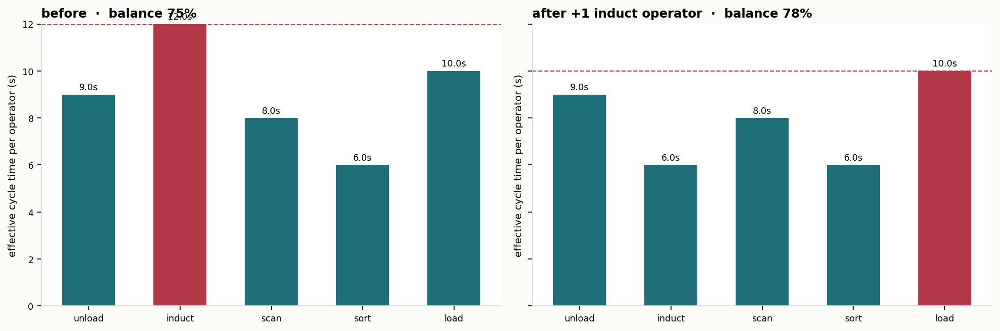
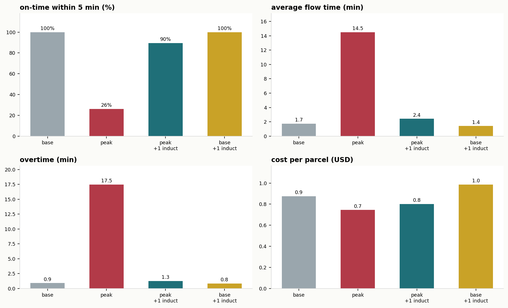
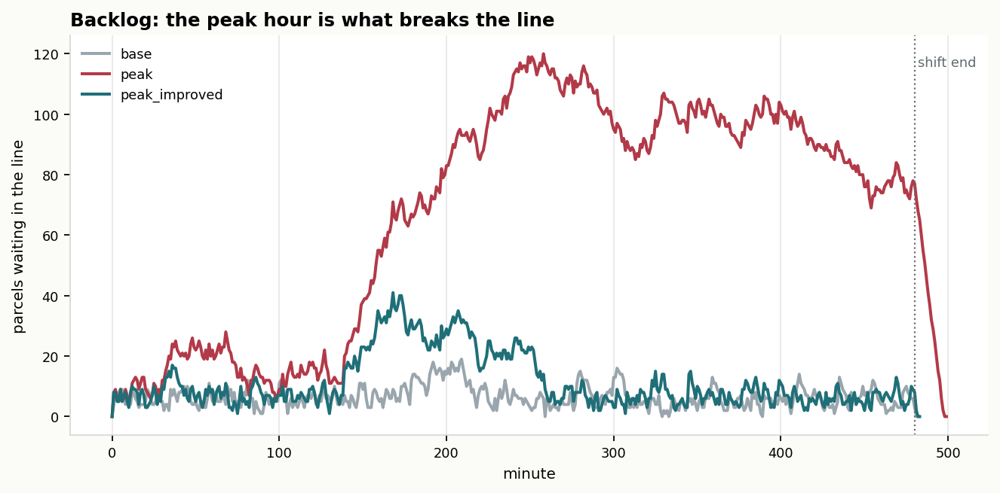

# 快递中转场分拣线：线平衡、产能与峰值用工

这是一个 IE 方法案例，不是顺丰的实测数据。时间研究参数是示例，换成你现场测的数据，同一套流程就能出山积图、平衡率、瓶颈、加班和单票成本。

我想回答的问题很具体：**一条分拣线，瓶颈在哪？峰值来了要加几个人？加在哪个工位？加了之后成本涨多少、时效回来多少？**

## 场景

一条五工位的分拣线：

`卸车 → 供包 → 扫描 → 分拣 → 装车`

示例时间研究：

| 工位 | 单件作业内容（秒） | 变异系数 | 人数 | 可用率 |
|---|---|---|---|---|
| 卸车 | 18.0 | 0.25 | 2 | 0.92 |
| 供包 | 12.0 | 0.20 | 1 | 0.92 |
| 扫描 | 8.0 | 0.15 | 1 | 0.92 |
| 分拣 | 6.0 | 0.10 | 1 | 0.92 |
| 装车 | 20.0 | 0.25 | 2 | 0.92 |

- 班次 8 小时，到达不是均匀的：中间两小时是峰值，小时到达量是均值的 1.15 倍
- 基准货量 **220 件/小时**，峰值 **286 件/小时**（+30%）
- 服务目标：从到达至发运 **5 分钟内**
- 人工 25 美元/小时，加班 1.5 倍，设备/场地 0.10 美元/件

## 模型

### 线平衡

每个工位的有效节拍：

```
effective_cycle = work_content / operators
```

产能：

```
capacity = 3600 × availability / effective_cycle
```

线平衡率：

```
balance = Σ effective_cycle / (工位数 × max effective_cycle)
```

瓶颈就是有效节拍最大的工位，线产能取各工位产能的最小值。

### 排队仿真

不是用公式估，而是做串行排队仿真：

- 按分钟生成泊松到达，峰值小时乘 1.15
- 每个工位有若干并行服务台（人数）
- 服务时间服从对数正态，均值和 CV 来自时间研究
- 无限缓冲，不模拟阻塞、批次和设备故障
- 记录每件的流程时间、发运时间、加班和积压

### 成本

```
总成本 = 人工 + 加班 + 设备/场地
单票成本 = 总成本 / 处理件数
```

## 结果



| 场景 | 到达/h | 人数 | 瓶颈 | 平衡率 | 线产能/h | 平均流程 | 5 分钟准时率 | 加班 | 单票成本 |
|---|---|---|---|---|---|---|---|---|---|
| base | 220 | 7 | 供包 | 75% | 276 | 1.75 min | 100% | 0.9 min | $0.876 |
| peak | 286 | 7 | 供包 | 75% | 276 | 14.51 min | 26.2% | 17.5 min | $0.745 |
| **peak + 1 供包** | 286 | 8 | 装车 | 78% | 331 | **2.42 min** | **89.6%** | **1.3 min** | **$0.802** |
| base + 1 供包 | 220 | 8 | 装车 | 78% | 331 | 1.40 min | 100% | 0.8 min | $0.987 |





几个判断：

- **线平衡率只从 75% 涨到 78%，但线产能从 276 涨到 331（+20%）**。平衡率是个比率，瓶颈工位的绝对产能才是关键；只看平衡率会低估加人的收益。
- 峰值时加 1 个供包人：准时率从 26% 回到 90%，平均流程从 14.5 分钟降到 2.4 分钟，单票成本只涨 7.7%。这 1 个人的边际收益最高，因为加在了瓶颈上。
- 平时加同一个人：准时率本来就是 100%，流程从 1.75 降到 1.40 分钟，单票成本涨 12.7%。**同样的动作，峰值是救火，平时是浪费。**
- 峰值单票成本看起来比 base 低（$0.745 vs $0.876），是因为货量摊薄了固定人工；不能拿不同货量的单票成本直接比，要比同一货量下的方案。

## 怎么换成你的现场数据

改 `data/time_study.csv` 就行：

```csv
station,work_content_sec,cv,operators,availability
unload,18.0,0.25,2,0.92
...
```

- `work_content_sec`：单件在该工位的作业时间，建议测 10–20 次取均值
- `cv`：时间研究的变异系数，没有就先用 0.2
- `operators`：该工位人数
- `availability`：扣除休息、故障、等待后的可用率

到达曲线在 `scripts/run_analysis.py` 的 `profile` 里改；默认是 8 小时、中间两小时峰值。

## 局限

- 服务时间假设独立同分布，实际会有学习曲线、疲劳和工位间协助
- 无限缓冲，没有模拟阻塞和批次
- 没有设备故障、换班、外包工技能差异
- 时间是示例参数，不是顺丰实测；结论用于方法演示
- 只算人工、加班、设备/场地，没算破损、错分、客户投诉

## 对应顺丰 IE

这个案例直接对应中转 IE 的几件事：

- **场地成本/效能**：单票成本、加班、人工结构
- **用工结构**：峰值加人、加在瓶颈、平时不加
- **产能测算**：线产能、瓶颈、峰值缺口
- **线体平衡**：山积图、平衡率、ECRS
- **场地布局/工装**：下一步可以把工位间距离、搬运和工装夹具加进来

## 运行

```bash
pip install -r requirements.txt
python scripts/run_analysis.py
python tests/test_hub.py
```

结果在 `results/`，图在 `images/`。
