# 供应链运营分析平台

[](https://www.python.org/)
[](https://www.sqlite.org/)
[](https://streamlit.io/)
[](LICENSE) [](https://github.com/lingtao-meng/supply-chain-operations-analytics/actions/workflows/ci.yml)

仓库包含三个案例。

- **DataCo 运营分析**（根目录）：180,519 条订单明细，SQLite 星型模型、10 条 SQL、Streamlit 仪表板，加上 Laney p′、Ppk、Pareto 和派工仿真。
- **制造 IE 装配线与班次产能优化**（[`manufacturing/`](manufacturing/)）：用四套公开基准做工位分配、缓冲选址、班产验收和改线比较。
- **快递中转场分拣线 IE**（`express/`）：五工位时间研究案例、山积图/线平衡、排队仿真、峰值用工和单票成本。

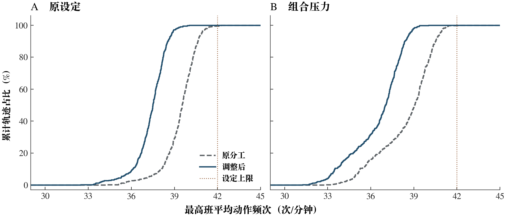

50:50 混线仿真中，假设第 5 工位每件 B 型件减少一次动作。两条阶梯线分别给出原分工与调整后的累计分布。每种工况复用同一批 400 条轨迹。竖线是每分钟 42 次的情景上限，曲线在该处的高度表示未超限的轨迹占比。[工位诊断、交付验收与假设](manufacturing/CONSTRAINED_RELEASE.md)

---

## DataCo 运营分析

清洗后的数据存入 SQLite 星型模型。仓库提供 10 条 SQL 查询及使用 Streamlit 和 Plotly 的交互仪表板。

- First Class 的计划时效为 1 天，实际平均 2 天，样本准时率为 0%。Second Class 计划 2 天，实际平均约 3.9 天。Standard Class 计划 4 天，实际平均 4 天，准时率约 60%。
- 超过一半的延迟集中在 1–3 天。五个市场的准时率分布在 42.0%–43.2%，最大差距约 1.2 个百分点。运输方式之间的差异更大。
- 按年份、市场和运输方式筛选后，仪表板汇总准时率、延迟天数及延迟订单行的金额。

## 项目结构

`app/app.py` — Streamlit 仪表板  
`manufacturing/` — 装配线工序分配、工位负荷与节拍敏感性  
`express/` — 快递分拣线 IE（时间研究、线平衡、仿真）  
`python/` — 数据清洗和入库脚本  
`sql/` — 建表 DDL 和 10 条分析查询  
`notebooks/` — Jupyter 深度分析  
`tests/` — SQL / IE 测试  
`images/` — 仪表板截图  
`setup.sh` — 一键初始化

---

## 运行

```bash
git clone https://github.com/lingtao-meng/supply-chain-operations-analytics.git
cd supply-chain-operations-analytics

pip install -r requirements.txt

# 先跑数据清洗（需要先下载 DataCo 数据集，改一下 INPUT_PATH）
python python/01_data_cleaning.py
python python/02_load_to_db.py

# 快递分拣线 IE 模块
cd express
pip install -r requirements.txt
python scripts/run_analysis.py
python tests/test_hub.py
cd ..

# 启动仪表板
streamlit run app/app.py

# 或者一步到位
bash setup.sh && streamlit run app/app.py
```

数据集从 Kaggle 下载：[DataCo Supply Chain Dataset](https://www.kaggle.com/datasets/evilspirit05/datasupplychain)（93MB，180,519 条记录）。

App 启动时可通过 KaggleHub 下载数据，并在清洗后建库。

---

## SQL 分析

10 条查询放在 `sql/02_analytics_queries.sql`，主要用到的写法：

- 窗口函数：滚动均值、环比、同比（LAG 按品类分区回溯 12 个月）
- CTE 做多层聚合，再套 NTILE 分位数排名
- Pareto 分析看延迟集中在哪些运输×市场组合上
- 条件聚合做延迟分级统计

验证查询跑通：

```bash
python tests/test_sql_queries.py
```

---

## 仪表板页面

| 页面 | 内容 |
|------|------|
| 交付绩效 | KPI 卡片、月度趋势折线、运输方式排名、延迟等级分布 |
| 运输与物流 | 准时率 vs 交付天数散点、市场区域差距、运输×市场热力图 |
| 品类与市场 | 品类准时率排名、收入树状图、品类×市场热力图 |
| 延迟分布 | 延迟直方图、Pareto 图、分组准时率极差、季度趋势 |
| 数据概览 | 缺失值报告、数值分布、Schema 图 |

侧边栏可按年份、运输方式和市场筛选。交付绩效页显示当前样本的统计摘要，筛选后的数据可导出为 CSV。

---

## 工业工程视角：过程质量与排程

过程质量部分比较月度迟到率和运输方式。排程部分在固定产能下比较各派工规则的交期表现及在制订单。

### 1. 过程质量：Laney p′ 控制图 + 过程能力 + Pareto

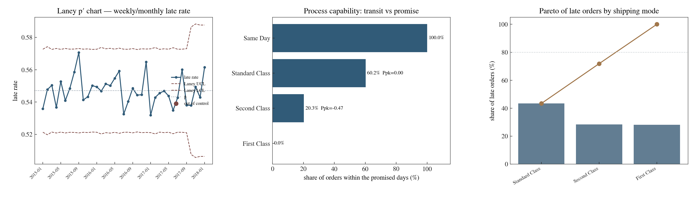

- **Laney p′ 控制图**：月度迟到率 p̄ = 54.7%。用普通 p 图会有 **1 个点越界**；按过度离散校正
  （Laney 因子 1.25）后 **0 个点越界**。
- **过程能力**（USL = 承诺天数）：

| 运输方式 | 承诺 | 平均实际 | 合格率 | Ppk | DPMO |
|---|---|---|---|---|---|
| Same Day | 0 | 0.00 | 100% | —（零方差） | 0 |
| Standard Class | 4 | 4.00 | 60.2% | 0.00 | 397,682 |
| Second Class | 2 | 3.99 | 20.3% | −0.47 | 797,308 |
| First Class | 1 | 2.00 | 0% | —（零方差） | 1,000,000 |

样本内 First Class 的实际时长固定为 2 天。Second Class 的 Ppk 为 −0.47，平均实际时长超过计划时效。

- **Pareto**：迟到订单 43.4% 来自 Standard、28.4% Second、28.2% First，Same Day 为 0。
  Pareto 图按各运输方式的迟到订单行占比排序。

### 2. 排程仿真：规则、WIP、人力

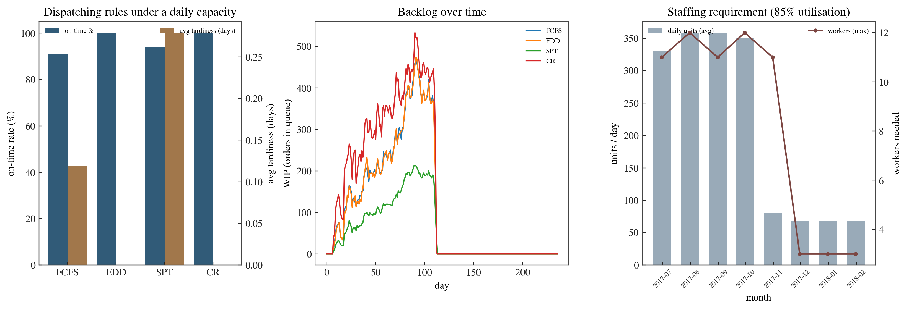

对最后 15%（27,078 行明细、231 天）做单阶段排程仿真：每天产能 348 单位（日量的 p75），订单有释放日、
承诺交期、加工量（件数），比较四种派工规则：

| 规则 | 准时率 | 平均延迟 | 最大延迟 | 平均 WIP | 平均流程时间 |
|---|---|---|---|---|---|
| FCFS | 91.0% | 0.12d | 3d | 108 | 0.94d |
| EDD | **100%** | **0** | **0** | 107 | 0.93d |
| SPT | 94.2% | 0.28d | 10d | **53** | **0.47d** |
| CR | **100%** | **0** | **0** | 144 | 1.26d |

在该产能设定下，EDD 和 CR 的模拟准时率均为 100%。SPT 的平均在制订单和流程时间最少，最大延迟为 10 天。

容量敏感性更能说明问题：

| 日产能 | FCFS 准时 | EDD 准时 | SPT 准时 | CR 准时 |
|---|---|---|---|---|
| 348（p75） | 91.0% | 100% | 94.2% | 100% |
| 300（−14%） | 39.5% | 38.5% | 93.1% | 38.5% |

日处理能力降低约 14% 后，FCFS、EDD 和 CR 的模拟准时率均低于 40%。SPT 的准时率为 93.1%，最大延迟增至 64 天。

人力：40 件/人/天、85% 利用率下，峰值需要 **12 人**，中位数 3.5 人；图 3 给出月度人力曲线。

```bash
python python/03_ie_quality.py
python python/04_ie_scheduling.py
python python/04_ie_scheduling.py --capacity 300   # 容量敏感性
```

---

## 制造 IE 装配线平衡

[一页案例](manufacturing/CASE_BRIEF.md) · [五分钟演示](manufacturing/DEMO.md) · [完整实验地图](manufacturing/EXPERIMENTS.md)

Mitchell 节拍 15 时，最长工序优先需 9 个工位，整数规划需 8 个。在 3 个缓冲位的设计条件下，固定样本最优班产为 1,590 件，独立验收的计划量为 1,570 件。返工、停机和混线发运另设工况，成本及回收期按可替换的人民币费率测算。[制造项目主页](manufacturing/README.md) · [公开约束与工序缩时](manufacturing/ASSIGNMENT_BENCHMARK.md)

## 快递分拣线 IE 模块

`express/` 是一个独立的分拣线案例：卸车 → 供包 → 扫描 → 分拣 → 装车，五工位、8 小时班次、基准 220 件/小时、峰值 286 件/小时。

时间研究、到件率和用工依据案例设定，用于比较仿真方案。

- 峰值基准的五分钟准时率为 18.9%，平均流程时间为 19.53 分钟。
- 峰值供包增加一人后，五分钟准时率为 95.3%，单票成本由 0.758 美元升至 0.798 美元。

完整结果、图和数据替换步骤见 [`express/README.md`](express/README.md)。

## 运营分析图表

运营图库取已完成订单行。建库后运行 `python python/plot_operations.py` 可重绘下列八图。

| | |
|:---:|:---:|
| 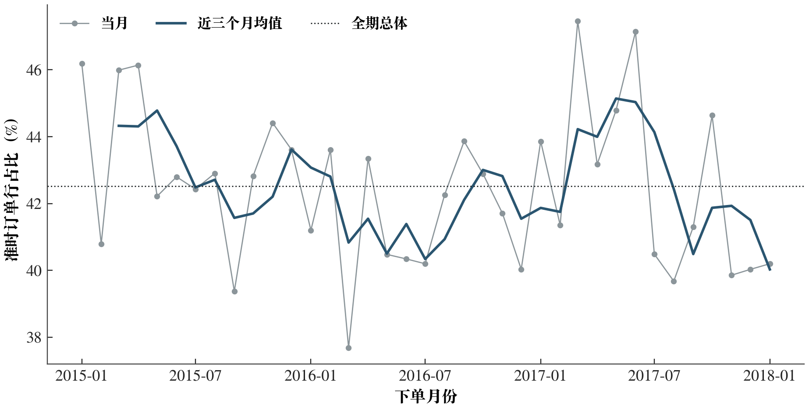 | 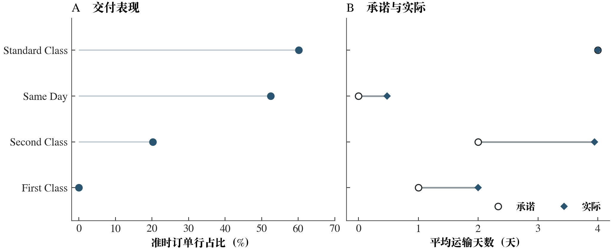 |
| 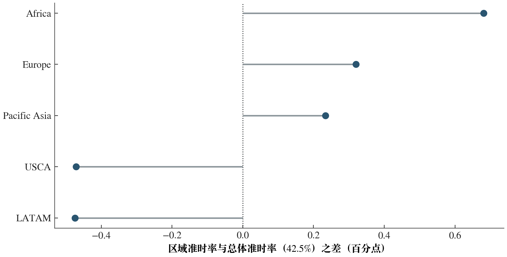 | 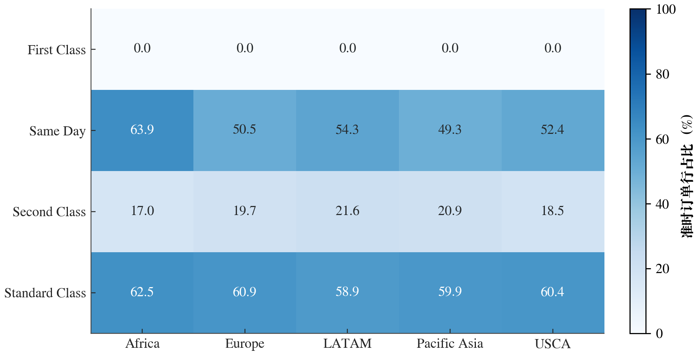 |
| 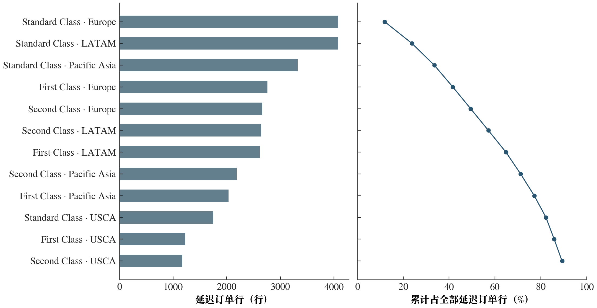 | 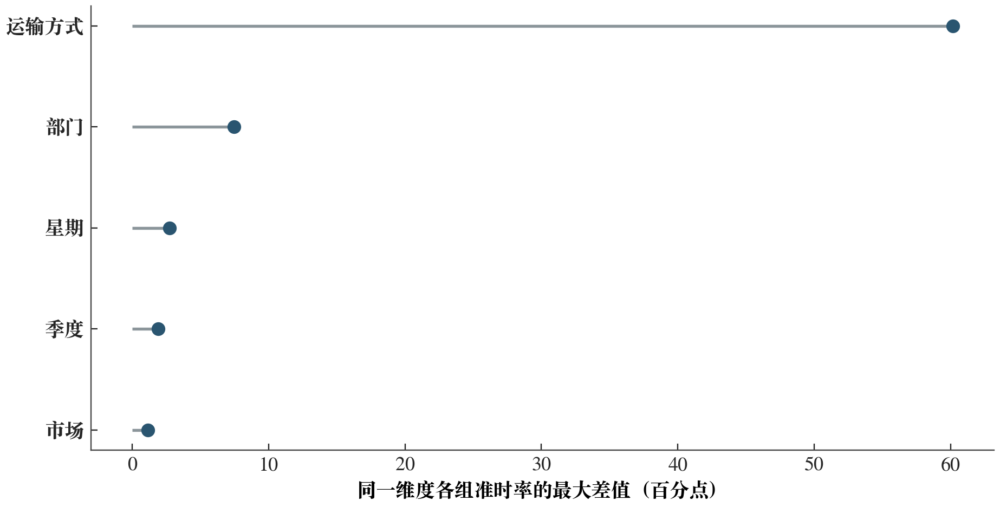 |
| 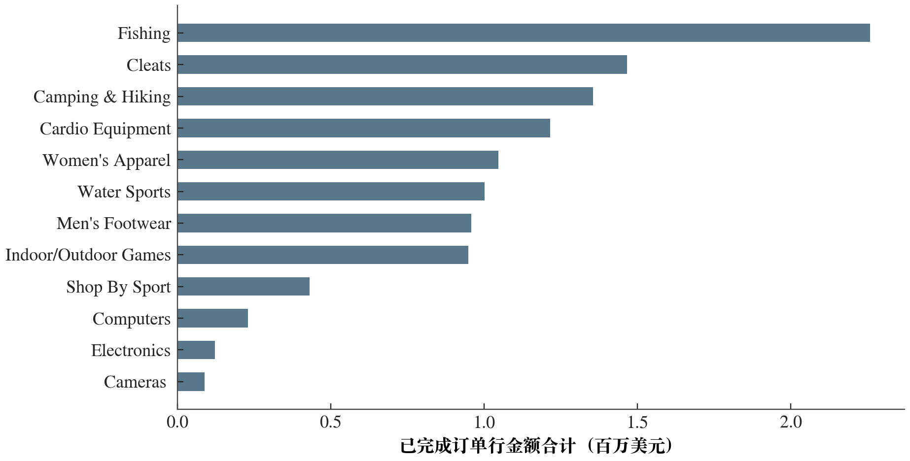 | 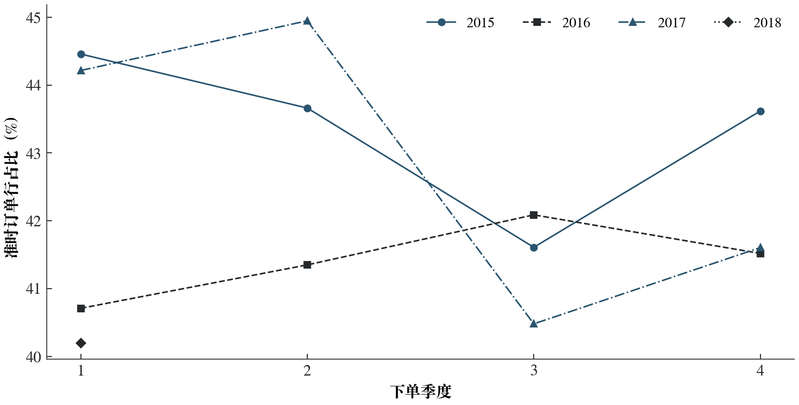 |

---

## 数据质量与 KPI 断言

`tests/test_kpis.py` 核对以下公式、事实表粒度和样本结果。

- `delay_days = 实际 − 承诺`，与两列日期一致
- `on_time = 1` 当且仅当 `delay_days ≤ 0`
- 各运输方式准时率落在 [0, 100]，且事实表粒度是订单行（`fact_id` 唯一）
- 五个市场的样本准时率极差低于 5 个百分点
- First Class 准时率 < 1%，计划时效为 1 天且实际平均时长更长

```bash
python tests/test_kpis.py        # 无需 pytest
python tests/test_sql_syntax.py  # 用空库验证 DDL + 10 条查询的语法与列名
pytest tests/ -q                 # 或按标准方式跑
```

## 技术栈

Python (pandas, numpy, scipy) → SQLite → Streamlit + Plotly → Matplotlib（IE 分析）→ Jupyter

---

MIT License
