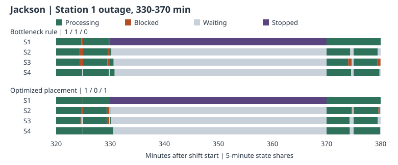

# 同预算缓冲布置与停机验收

本实验固定每条线的工序分配、班长和两个缓冲位，比较均匀布置、按名义瓶颈布置和按仿真选位。Jackson 延续上一轮案例，目标为 1,780 件/班。Sawyer 是首次用于本项目的 Scholl 公开工序基准，共 30 道工序和 32 条直接先后关系。Sawyer 固定 8 个工位，名义峰值 41 秒。按 Jackson 目标的名义产能比例换算，取 520 件/班。Sawyer 工位分工在停机实验前按静态线平衡求得。 [Scholl 数据说明](https://assembly-line-balancing.de/salbp/benchmark-data-sets-1993/) · [Sawyer 原始工序文件](https://github.com/jordipereiragude/salbp2instances/blob/844e6372da359b1b53f933e7f6e7051b08a414f1/scholl/SAWYER30.IN2)

## 方案与样本

| 布置规则 | Jackson | Sawyer |
| --- | --- | --- |
| 均匀布置。将工位间的可选位置等分成两段，各取中间位置 | 第 1、3 段 | 第 2、6 段 |
| 按瓶颈布置。选最靠近第一个名义最忙工位的两段 | 第 1、2 段 | 第 1、2 段 |
| 仿真选位。枚举恰好两个缓冲位的所有布置，选最差工况所需工时最短者 | 第 1、3 段 | 第 4、6 段 |

两条线沿用 [停机模型](DOWNTIME_RECOVERY.md)。在设计阶段，每个工位分别在开班后第 120 或 300 分钟停机 30 分钟，用同一批 120 个模拟班次计算每个配置第 119 个最早的目标完工时刻。选位规则固定后，在 Sawyer 设计样本上重新计算位置，验收样本独立生成。两个工序图各用 300 个验收班次，每个工位分别在第 90 或 330 分钟停机 25 或 40 分钟。

按每条线的三套方案和全部停机情景进行 Bonferroni 校正，以单侧精确二项下界判断 95% 达标率门槛。Jackson 每个情景至少要有 296 班达标，Sawyer 至少 297 班。同一条线的方案共用逐件工时。缓冲区平均在制品只统计在等待位中的工件，按占用时长加权。补产时间取各情景达到相应验收班次数所需的最长延时。

## 留出工况结果

| 基准 | 停机 | 布置 | 最少达标班数 | 最差平均缺口（件） | 最大需补产时间 | 平均缓冲在制品（件） |
| --- | ---: | --- | ---: | ---: | ---: | ---: |
| Jackson | 25 分钟 | 均匀 / 仿真选位 | 299/300 | 0.01 | 0 | 1.01 |
| Jackson | 25 分钟 | 瓶颈 | 297/300 | 0.16 | 0 | 1.61 |
| Jackson | 40 分钟 | 均匀 / 仿真选位 | 289/300 | 0.80 | 3 分 10 秒 | 1.01 |
| Jackson | 40 分钟 | 瓶颈 | 247/300 | 4.79 | 12 分 57 秒 | 1.59 |
| Sawyer | 25 分钟 | 均匀 | 149/300 | 6.13 | 26 分 13 秒 | 1.23 |
| Sawyer | 25 分钟 | 瓶颈 | 82/300 | 13.03 | 35 分 19 秒 | 1.89 |
| Sawyer | 25 分钟 | 仿真选位 | 196/300 | 3.57 | 22 分 01 秒 | 0.88 |
| Sawyer | 40 分钟 | 均匀 | 35/300 | 20.08 | 41 分 13 秒 | 1.22 |
| Sawyer | 40 分钟 | 瓶颈 | 11/300 | 30.13 | 50 分 19 秒 | 1.88 |
| Sawyer | 40 分钟 | 仿真选位 | 68/300 | 15.37 | 37 分 01 秒 | 0.87 |

Jackson 的均匀规则和仿真选位给出相同布置，停机 25 分钟时通过验收，40 分钟时均需增加净生产时间。Sawyer 的仿真方案在 25 分钟停机情景下，较均匀布置平均每班少缺 **2.39 件**，配对 95% 区间为 **2.09–2.68 件**。区间对共享工时的完整班次重抽样 2,000 次，每次等权汇总各工位和停机时点。Sawyer 的三套方案均未通过 520 件目标，选位收益应与额外净工时、缓冲预算或班产调整一起判断。

## 工位状态与班产取舍



图使用第一个验收班次，比较两种布置下第 1 工位从第 330 到第 370 分钟停机的过程。绿色为加工，橙色为阻塞，灰色为等料，紫色为停机。每格按五分钟内四种状态的耗时占比绘制。两套布置都在第一段留一位，差别在第二个缓冲位。第三段留位后，第 3 工位加工完成的工件可以进入等待位，工位可提前接下一件。个别班次的工位轨迹用于解释过程，方案验收使用上表的完整样本。

下表给出 Jackson 在设计工况下，不同班产和缓冲预算需要增加的净生产时间。三档目标取同一批工时序列的前缀。1,720 件用一位即可在设计班长内完成，1,750 和 1,780 件需要两位。该表用于选型，验收结论见上表。

| 班产目标 | 零缓冲 | 最多一位 | 最多两位 | 最多三位 |
| ---: | ---: | ---: | ---: | ---: |
| 1,720 件 | 5 分 17 秒 | 0 | 0 | 0 |
| 1,750 件 | 12 分 13 秒 | 1 分 34 秒 | 0 | 0 |
| 1,780 件 | 18 分 59 秒 | 8 分 08 秒 | 0 | 0 |

公开数据提供名义工时和先后关系。停机时点、工时波动和复机后继续加工是仿真假设。涉及复机点检、首件放行或报废时，需在试产记录中单独计时。

```bash
python manufacturing/buffer_holdout.py
```

[方案、验收及配对比较](results/buffer_holdout.json) · [逐工位情景明细](results/buffer_holdout.csv) · [试产复核表](PILOT_CHECKLIST.md)
