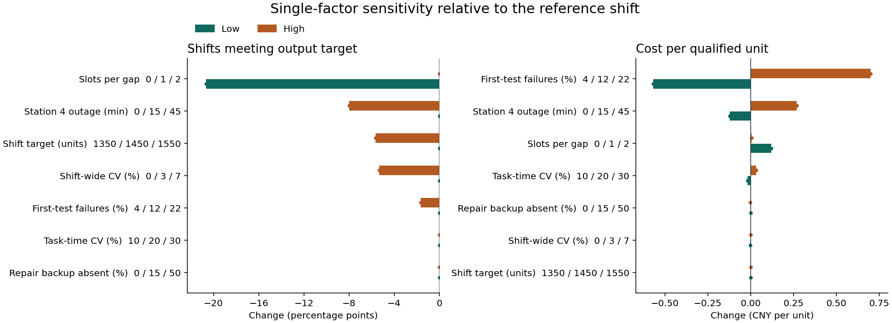

# 班次成本、回收期与七因素敏感性

Mitchell 的静态分工从最长工序优先的 9 站变为整数规划的 8 站。两者各段设一个缓冲位，分别占用 8 位和 7 位。比较同一批 300 个模拟班次，统一使用 420 分钟、一个首检位、两个可用返工位（备用人员可能缺勤），第 4 站在第 120 分钟停机。质量放行时刻决定当班合格量。此处只计算列明的可比成本。

| 可替换的人民币假设 | 入账方式 |
| --- | --- |
| 装配工 38 元/小时，每年 250 班 | 工位数 × 7 小时 × 费率 |
| 缓冲占地 900 元/位·年，在制品货值 260 元/件，年持有率 20% | 空间按设置位数收费，资金占用按班内时间平均的缓冲等待件数收费 |
| 停机 8 元/分钟 | 仅计设备直接损失。产量变化通过合格件分母体现 |
| 返修 6 元/件、复检 2 元/件 | 每次班内完成返修及复检均计费，含最终判废。返工按件结算，装配人员工资独立 |
| 一次性改线 48,000 元 | 投资单列，静态回收期按改线费除以年度运营成本差计算 |

**单件可比成本由 2.456 元降至 2.189 元。** 分母取全部班次合格件之和。按相同年度班次数，少一个装配岗位的可释放人工为 66,500 元/年，少一个缓冲位的占地为 900 元/年。另按实际等待量计持有费。整数规划方案平均每班多完成约 10 次返修，增加的返修及复检费用抵掉部分节省。合计年度情景节省 **47,281 元**，配对 95% 区间约为 46,646 至 47,916 元，简单回收期 **1.02 年**，首年净 ROI 约 **−1.50%**。两方案合格产量不同；未计新增产量的销售收益、残值、税费与折现。若岗位工资或场地费用无法释放，需调低对应费率重算。

## 七个因素的同口径比较



每次只改变表中一个因素，复用相同的工时、质量及备员可用性随机数。基准目标为每班 1,450 件合格品，基准 300/300 班达标。按低、高档相对基准的达标率跨度排序。区间只表示相邻已测试档位之间的验收变化，未连续搜索精确阈值。

| 因素 | 低 / 基准 / 高 | 样本达标率（%）低 / 基准 / 高 | 单件成本（元）低 / 高 | 95% 可靠性验收变化 |
| --- | --- | --- | --- | --- |
| 每段缓冲位 | 0 / 1 / 2 | 79.33 / 100 / 100 | 2.308 / 2.195 | 从 0 到 1 位转为通过 |
| 停机分钟 | 0 / 15 / 45 | 100 / 100 / 92.00 | 2.068 / 2.459 | 15 至 45 分钟之间失守 |
| 班产目标 | 1,350 / 1,450 / 1,550 | 100 / 100 / 94.33 | 2.189 / 2.189 | 1,450 至 1,550 件之间失守 |
| 整班工时变异系数（%） | 0 / 3 / 7 | 100 / 100 / 94.67 | 2.186 / 2.188 | 3% 至 7% 之间失守 |
| 首检不合格率（%） | 4 / 12 / 22 | 100 / 100 / 98.33 | 1.621 / 2.889 | 三档均通过，单件成本跨度最大 |
| 单工序工时变异系数（%） | 10 / 20 / 30 | 100 / 100 / 100 | 2.171 / 2.220 | 测试范围内均通过 |
| 返工备员缺勤概率（%） | 0 / 15 / 50 | 100 / 100 / 100 | 2.190 / 2.186 | 测试范围内均通过 |

首检不合格后以 80% 概率进入返修，返修成功概率为 85%。调高首检不合格率会相应增加返修量及直接报废量。连续量用班次配对差及 t 区间，同时列出标准化配对效应。达标率差按同一班次的两个不一致方向分别求精确二项界，合成保守差值区间。14 项对照使用 Bonferroni 校正。敏感性网格含基准的 15 个达标率，单侧精确下限按 15 项校正。差值无变动时不报告标准化效应。缺勤按返工服务能力建模，未对释放的闲置工时计收益。

[假设表](data/cost_assumptions.json) · [逐档成本、效应量和区间](results/decision_sensitivity.csv) · [汇总与复算数据](results/decision_economics.json)

```sh
python manufacturing/decision_economics.py --rates manufacturing/data/cost_assumptions.json --output-dir reproduced
```
