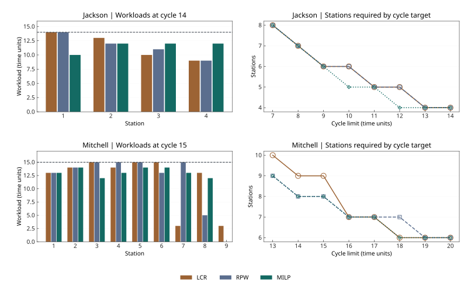

# 实验地图与复现入口

| 制造 IE 问题 | 方案和验收结果 |
| --- | --- |
| 缩减欠发和达到交付目标，分别该先投哪一项 | 同批验证供料、平行工位、返工的八种组合，比较同目标成本与不同预算的验收档位。 [混线欠交与投资选择](MIXED_LINE_DECISIONS.md) |
| 欠交来自哪里，先调排产、移工序还是加设备 | 拆解班末积压与工位占用，在相同订单下比较原人数分工和新增平行工位的连续两班交付能力。 [工序再分配与旧单积压](FACTORY_REBALANCE.md) |
| 布局和看板怎样影响混线交付 | 对比零缓冲、搬运距离、方向换型、二次返修及岗位负荷。 [工位间物流与人体工学代理](FACTORY_FLOOR_STUDY.md) |
| 分区、平行工位和预算怎样影响班产承诺 | 110 个仿真资源点的方案在 800 组留出中支持每班 1,030 件，来料晚 30 分钟时失守；60 点方案的 980 件承诺在组合压力下仍通过。 [预算、分区与敏感性](FACTORY_CAPACITY_PLAN.md) |
| 合格品做出来了，为什么还是赶不上发车 | 加入来料检验、工位点检与定时发运。700 组独立复验中，同样的来料工位和车辆载量下，第二个异常班平均按期发运由 1,275.48 增至 1,361.22 件。 [从来料到车辆发运](FACTORY_DISPATCH.md) |
| 现场同时缺料、限人、限空间时先改什么 | 两型号共线仿真中，齐料优先、培训储备人员和到料提前组合后，第二个异常班平均欠交由 434.3 降至 106.1 件。 [五类工厂约束与按型号交付](FACTORY_SIMULATION.md) |
| 固定 8 个工位、3 个缓冲位，如何分工和选位置 | Mitchell 认证设计班产为 1,590 件，1,570 件的计划目标通过独立仿真验收。 [分支定界与最优性认证](CERTIFIED_SEARCH.md) |
| 关键工序工时增加 45%，怎样用较小改线恢复达标 | Jackson 只移动工序 6，并在后两段各留 1 位。较差工况下 296/300 班达成 1,780 件。 [工时偏差下的改线](RECONFIGURATION.md) |
| 单工位停机 30 分钟，缓冲能保住多少班产 | Jackson 保持原工序分配，设置 `1 / 0 / 1` 缓冲后，最差场景由 214/300 班达标增至 299/300 班。 [停机与班产恢复](DOWNTIME_RECOVERY.md) |
| 连续多件偏慢时，原班产还能承诺多少 | Mitchell 保持 8 工位、7 缓冲位，1,650 件的达标班次由 589/600 降至 247/600。按设计样本锁定 1,520 件后，三档工况均通过独立验收。 [连续慢件与班产承诺](PERSISTENT_WORKLOADS.md) |
| 修好设备后，还能留多久等待质量放行 | Jackson 设机械停机 25 分钟、使用两个缓冲位。设计样本锁定 10 分钟等待后，独立验收最差场景有 298/300 班达成 1,780 件。 [复机放行等待预算](RESTART_RELEASE.md) |
| 装配完工更多，合格班产会怎样变化 | Mitchell 在设定首检不合格率 18% 时，装配多完成约 133 件/班，合格放行反而少约 9 件。增配一人到返工比安排到首检多放行约 54 件/班。 [合格班产与返工配置](GOOD_OUTPUT.md) |
| 只有 90 分钟返工支援，什么时候安排 | Mitchell 前段集中不良时，积压触发把班内平均未关闭返工件数从 68.95 降到 42.09。后段集中时，两种 90 分钟安排均未通过班末交付验收。 [临时返工支援排班](REWORK_SUPPORT.md) |
| 同样 240 人分钟，怎样应对班末不良高峰 | Mitchell 最晚集中工况下，1 人长支援有 570/600 班达标，2 人并行支援有 599/600 班达标。 [等人时高峰返工支援](PEAK_REWORK_SUPPORT.md) |
| 连续异常产生的欠单，恢复后多久能清完 | Mitchell 连续 4 个异常班后，无支援方案平均积压 304.70 件返工。相同 240 人分钟下，单人长支援和两人并行分别积压 49.40 件和 3.42 件。 [跨班积压与交付](REWORK_CARRYOVER.md) |
| 质检区空间有限，等待位应该放在哪一侧 | Mitchell 最晚集中工况下，在岗安排相同，将 12 个等待位从首检前移到返工前，达标班次由 206/600 提至 599/600。风险批次靠前时，另检验提前支援。 [有限暂存与装配阻塞](FINITE_STAGING.md) |
| 连续两班都要交足 1,650 件，优先增加哪项资源 | 支援人时不变，返工等待位由 12 个增至 32 个。在独立复验的 3,000 组轨迹中，两班均达标的比例由 88.83% 升至 96.50%。 [工时、暂存与交付承诺](SUPPORT_BUDGET.md) |
| 两名返工支援是否分开到岗 | 对比 80 种规则，在 800 组独立轨迹的第二个异常班，根据等待件数和本批首检记录同时调人，平均欠交从 15.98 件降至 8.62 件。 [支援排班与调人计算工具](STAGGERED_SUPPORT.md) |
| 换班有积压时，何时调人返工 | Mitchell 的第二个异常班，在相同 240 人分钟预算下，等待达到 8 件时调人，较以减少欠交量为目标的固定排班平均多按期交付 323 件。 [跨班调度与验收](SHIFT_DISPATCH.md) |
| 给同样两个缓冲位，怎样比较位置规则 | Jackson 的均匀布置与仿真选位相同。Sawyer 的仿真方案减少缺口，但停机后仍无法在设定班长内达到 520 件的验收门槛。 [同预算对照与留出验收](BUFFER_HOLDOUT.md) |
| 原缓冲位置换一套工序图还能否用 | Buxey 在同样 8 个工位、3 个缓冲位下，迁移和重排都通过 520 件/班常态验收，两者在更强的整班波动下均跌破门槛。 [跨基准复核](TRANSFER_VALIDATION.md) |

| 成本、波动与回收期如何一起比较 | [成本与敏感性](DECISION_ECONOMICS.md) |
| 小型工序网络中能否复用同一分工和缓冲位置 | [三组生成算例](SMALL_GRAPH_VALIDATION.md) |

## 数据和比较口径

使用 [Scholl 装配线平衡公开基准](https://assembly-line-balancing.de/salbp/benchmark-data-sets-1993/)中的 Jackson（11 道工序）和 Mitchell（21 道工序）。[输入文件](data/benchmarks.json)保留了两例的工序用时和直接优先关系，可与[公开归档的原始 IN2 文件](https://github.com/jordipereiragude/salbp2instances/tree/844e6372da359b1b53f933e7f6e7051b08a414f1/scholl)核对。用时按基准时间单位计。每例对比 8 个节拍，Jackson 的 14 和 Mitchell 的 15 用于展示具体的工位分配。

一条优先关系如 `1 → 2`，表示工序 1 必须先做。两道工序可以分到同一工位，此时按表中的顺序执行。每道工序完整分给一个工位，各工位总工时不超过目标节拍。模型假定工时固定、每个工位串行作业，结果用于公开基准方案比较。

## 排工方法

| 方法 | 排工逻辑 |
| --- | --- |
| LCR（最长工序优先） | 在前置工序已分配且当前工位还放得下的工序中，优先选耗时最长的 |
| RPW（位置权重法） | 同样检查前置工序和剩余容量，优先选自身与全部后续工序总工时最大的。共享后续工序只计算一次 |
| MILP（混合整数线性规划） | 先找最少工位数，再在该工位数下压低最重工位负荷。用 SciPy 调用 HiGHS，校验最优状态与实际分配 |

MILP 用二元变量 `x[i,s]` 表示工序 `i` 是否分配到工位 `s`，`y[s]` 表示工位是否启用，`z` 表示峰值负荷。目标为 `(C + 1) × Σ y[s] + z`，其中 `C` 是目标节拍。因为 `0 ≤ z ≤ C`，少开一个工位的收益始终优先。约束要求每道工序只分配一次，启用工位连续编号，前置工序的工位编号不大于后续工序。每个工位的负荷同时受 `C × y[s]` 和 `z` 限制。总工时除以节拍向上取整是工位数的工时下界，两种排工法中较少的工位数提供上界。

## 结果

| 基准 | 目标节拍 | 方法 | 工位数 | 峰值负荷 | 平衡率 | 总空闲 |
| --- | ---: | --- | ---: | ---: | ---: | ---: |
| Jackson | 14 | LCR / RPW | 4 | 14 | 82.14% | 10 |
| Jackson | 14 | MILP | 4 | 12 | 82.14% | 10 |
| Mitchell | 15 | LCR | 9 | 15 | 77.78% | 30 |
| Mitchell | 15 | RPW | 8 | 15 | 87.50% | 15 |
| Mitchell | 15 | MILP | 8 | 14 | 87.50% | 15 |



- **Mitchell，节拍 15。** RPW 与 MILP 比 LCR 各少用 1 个工位，平衡率提高 9.72 个百分点。MILP 在同样 8 个工位下把峰值负荷由 15 降到 14，最忙工位多出 1 个时间单位的余量。工时下界是 7 个，考虑工序不可拆分和先后关系后，求解得到最少 8 个。
- **Jackson，节拍 12。** 两种排工法都要 5 个工位，MILP 用 4 个工位完成，平衡率从 76.67% 提高到 95.83%。节拍进一步压到 11 时，最少需要 5 个工位。
- **节拍与工位配置。** Mitchell 在节拍 13、14、16 和 18 时分别至少需要 9、8、7 和 6 个工位。对照曲线可以读出，节拍收紧到哪个位置需要加开工位。
- **平衡率与瓶颈。** 平衡率为总工时除以“工位数 × 目标节拍”，总空闲为二者之差。同一节拍下，两套方案工位数相同时平衡率相同，还可以用峰值负荷和最忙工位余量判断负荷分布。

## 班次产能与改善验证

用 Mitchell 案例继续分析给定班产目标下的配置。设定每班 1,650 件、最多 8 人和 14 个缓冲位，先用模拟情景筛选配置，再用独立随机种子复核达标率。所选方案用 8 个工位、7 个缓冲位，在 20% 工序波动与 3% 班次波动下，180 个模拟班次有 178 个达标。班次波动增至 5% 后，达标次数降到 158 个。

在 Jackson 基准上进一步联合优化工序分配与缓冲。筛选 209 套可行分工后，4 个工位、零缓冲方案在两种设定工况的独立复核中均为 180/180 班达标。在同样的 4 个工位下，沿用 Mitchell 的逐段缓冲规则会占用 3 个缓冲位，并提供更高的产量余量。

[Mitchell 班次产能验证](CAPACITY_STUDY.md) · [Jackson 联合优化与独立复核](JACKSON_OPTIMIZATION.md) · [标准工时与试产复核表](PILOT_CHECKLIST.md)

进一步按缓冲预算搜索可验收的班产目标，对照完整枚举与快速搜索，并检验关键工序变慢后的调整策略。 [产能边界与工序扰动](CAPACITY_FRONTIER.md) · [工时偏差下的最小改线](RECONFIGURATION.md) · [分支定界与最优性认证](CERTIFIED_SEARCH.md)

## 复现

在仓库根目录运行。使用已有的 NumPy、SciPy 和 Matplotlib 依赖。

```bash
python -m pip install -r requirements.txt
python manufacturing/line_balance.py
python manufacturing/test_line_balance.py
```

- [method_comparison.csv](results/method_comparison.csv) 给出 16 个节拍情景 × 3 种方法的工位数、峰值负荷、平衡率和空闲时间。
- [station_assignments.csv](results/station_assignments.csv) 列出每个工位的工序执行顺序、负荷、空闲和瓶颈标记。同一目标下可能有多套等价分配。
- [reference_station_plans.csv](data/reference_station_plans.csv) 固定班次仿真使用的参考分工。重新求解静态排工时，求解器可能返回另一套等价分配。仿真仍从这份独立输入读取工序顺序。
- 用 `--data 路径` 可以读取相同结构的工序数据。工序编号从 1 开始，工时和节拍均为正整数，先后关系必须无环。用 `--output-dir 路径` 可单独保存结果。
