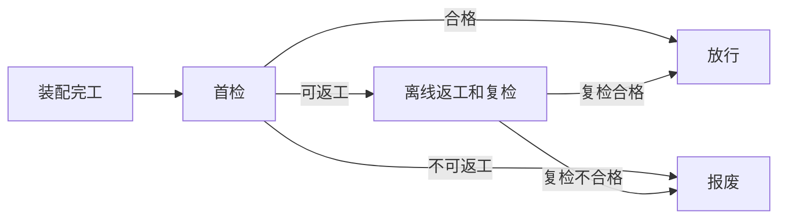

# 从装配完工到合格班产

加快装配后，能按时放行的合格品一定会变多吗？本实验沿用 Mitchell 的 8 个装配工位、7 个缓冲位和 420 分钟净班长，把原来的 1,650 件目标按**班末前放行的合格件数**重新验收。先算装配完工，再按逐件记录模拟首检、一次返工及复检、报废和班末待处理。



## 比较口径

- 复用公开基准的工序用时与先后关系，沿用混合整数排工方案。单件工时和整班共同波动的变异系数分别取 20% 和 3%。加快方案将所有装配作业用时乘以 0.93，工位分工、班长及缓冲位数保持一致。 [装配线基准](https://assembly-line-balancing.de/salbp/benchmark-data-sets-1993/)
- 首检每件 12 秒。首检不合格件中，设 80% 可以进入离线返工，其余直接报废。一次返工含复检共 120 秒，设复检合格概率为 85%。首检和返工各按先到先服务排队，班末未完成的保留为待处理。检验和返工区假定有足够暂存，排队不会反向阻塞装配。概率和时长都是情景输入。
- 每件只统计一次。**总完工＝合格放行＋报废＋待首检＋待返工。** 合格放行包括首检直接通过和当班返工复检通过。一次合格率以完成首检的件数为分母，返工后通过的件数另记。 [ASQ 一次通过率定义](https://asq.org/quality-resources/quality-glossary/) · [生产运营指标的数量口径](https://tsapps.nist.gov/publication/get_pdf.cfm?pub_id=919754#page=6)

## 选型与验收

每个方案共用对应班次的装配工时与逐件质量随机数。先用 300 个设计班次筛选同样配 1 个首检位和 1 个返工位的加快方案。首检不合格率从 4% 到 24% 每隔 2 个百分点取一档。进入下一步须至少有 292/300 班放行 1,650 件，且相对标准方案的配对平均增量的 95% 区间下界大于零。满足条件的最高档是 16%，18% 的设计结果为 285/300 班、平均少放行 10.03 件。

锁定 16% 后，换独立种子跑 600 个班次。六个方案的达标率按 Bonferroni 校正后的单侧精确二项下界检验，至少 **583/600** 班按时放行才通过 95% 达标率门槛。班产差的区间按对应班次配对计算，分别解释每组比较。

## 独立验收结果

| 方案 | 设定首检不合格率 | 首检 / 返工位 | 平均装配完工 | 平均合格放行 | 平均待返工 | 1,650 件合格班产达标 | 每百合格件人时 |
| --- | ---: | ---: | ---: | ---: | ---: | ---: | ---: |
| 标准装配 | 4% | 1 / 1 | 1,761.85 | 1,738.03 | 0.33 | 566/600 | 4.028 |
| 加快，品质稳定 | 4% | 1 / 1 | 1,895.03 | 1,869.33 | 0.33 | **600/600** | **3.745** |
| 加快，品质波动 | 18% | 1 / 1 | 1,895.03 | 1,728.82 | 65.97 | 570/600 | 4.049 |
| 同一品质波动，增首检位 | 18% | 2 / 1 | 1,895.03 | 1,728.92 | 65.98 | 570/600 | 4.454 |
| 同一品质波动，增返工位 | 18% | 1 / 2 | 1,895.03 | 1,783.35 | **1.70** | **596/600** | 4.318 |
| 加快，设计锁定档 | 16% | 1 / 1 | 1,895.03 | 1,765.24 | 37.22 | **593/600** | 3.965 |

每百合格件人时按所有在岗人员的班次时长除以平均放行量后换算。每个首检位或返工位假定配 1 人，该指标用于比较用工量。

- **装配完工和合格交付分开报。** 在 18% 情景下，加快后平均装配完工增加 133.18 件，合格放行平均减少 **9.21 件**，配对 95% 区间为减少 7.83–10.58 件。600 班全部达到装配完工目标，其中 **30 班**的合格放行量低于目标。
- **同样增配一人，优先缓解返工积压。** 增返工位比增首检位平均多放行 **54.43 件/班**，配对 95% 区间为 53.26–55.60 件。增返工位时，复检失败在当班更早完成处置，平均报废由 99.24 件增至 108.98 件，同时班末待返工从 65.97 件降至 1.70 件。
- **现有人力先盯首次质量和待返工。** 16% 是已通过独立验收的最高设计筛选档，合格放行比标准方案平均多 **27.21 件/班**。班末仍有约 37 件待返工，可与交付达成一起跟踪。实际提速、加人或放行，需要按产品与班次采集工时及质量去向后重新估算。 [试产复核表](PILOT_CHECKLIST.md)

## 复现

```bash
python manufacturing/test_good_output.py
python manufacturing/good_output.py
```

[设计筛选、配置与对比结果](results/good_output.json) · [独立样本逐班数量](results/good_output_holdout.csv)

若额外返工人员只能短时到位，可按[临时返工支援排班](REWORK_SUPPORT.md)对比定时派工和积压触发。

若质检区域的空间有限，可用[有限暂存与装配阻塞](FINITE_STAGING.md)核对返工积压何时会卡住首检和装配。
