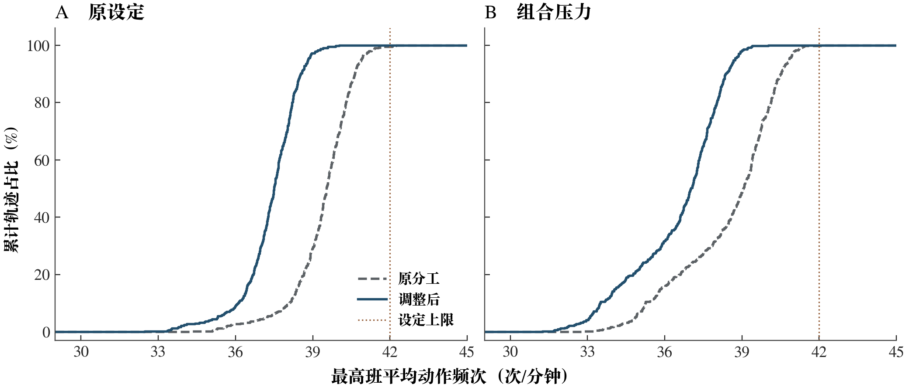

# 装配线平衡与班产决策

给一张工序表、一个班产目标和有限的工位，怎样决定先调整分工、挪缓冲，还是加设备？本项目先检验工序安排，再沿生产时间线追踪阻塞、返工和按期发运。

[一页案例](CASE_BRIEF.md) · [五分钟演示](DEMO.md) · [实验地图与复现入口](EXPERIMENTS.md)



[动作频次的逐班诊断与独立验收](CONSTRAINED_RELEASE.md)


- **静态排工。** Mitchell 节拍 15 时，最长工序优先需 9 个工位，整数规划需 8 个。工位数相同时，再比较最忙工位的负荷。[静态排工与结果](EXPERIMENTS.md#结果)
- **班产承诺。** 同一基准配置 3 个缓冲位，固定设计样本上的最优班产为 1,590 件，独立验收的计划量为 1,570 件。[搜索证书与验收](CERTIFIED_SEARCH.md)
- **异常恢复。** Jackson 停机 30 分钟时，较差工况下由 214/300 班达标提高到 299/300 班。连续慢件和集中返工另按各自交期验收。[停机](DOWNTIME_RECOVERY.md) · [慢件](PERSISTENT_WORKLOADS.md) · [返工](FINITE_STAGING.md)
- **有限资源。** 混线仿真中，第 4 工位扩容是减少累计欠发最有效的单项措施。基准工况每班交足 500 件时，单改返工成本最低。到料晚、人员缺勤和返工提速打折的组合压力下，平行工位加返工方案仍通过这一档。[同目标成本](MIXED_LINE_DECISIONS.md) · [联合压力复验](MIXED_LINE_STRESS.md) · [有限暂存](SUPPORT_BUDGET.md) · [投料规则与型号欠交](BALANCED_RELEASE.md)

## 局限与适用边界

Jackson、Mitchell、Buxey、Sawyer 的工序名义用时和前置关系来自公开基准。工时波动、质量、缺勤、班次、库区、搬运、人机负荷及费率采用情景设定。附加的三张工序图由固定种子生成。结论适用于报告列明的工艺、资源和交付口径，现场验证还需实测。[试产采集清单](PILOT_CHECKLIST.md)

“认证”指搜索上下界在固定设计样本、候选集合和预算内相等。独立班次验收检验锁定方案的可靠性。不同专题分别统计装配完工、质量放行或按期发运，比较时须使用相同口径。

## 本地复现

在仓库根目录安装依赖后，`make test-fast` 运行核心测试和文案核对，`make verify` 另行复跑完整数值实验。单项命令见各专题。

```sh
python -m pip install -r requirements.txt -r manufacturing/requirements-search.txt
make test-fast
make verify
```
