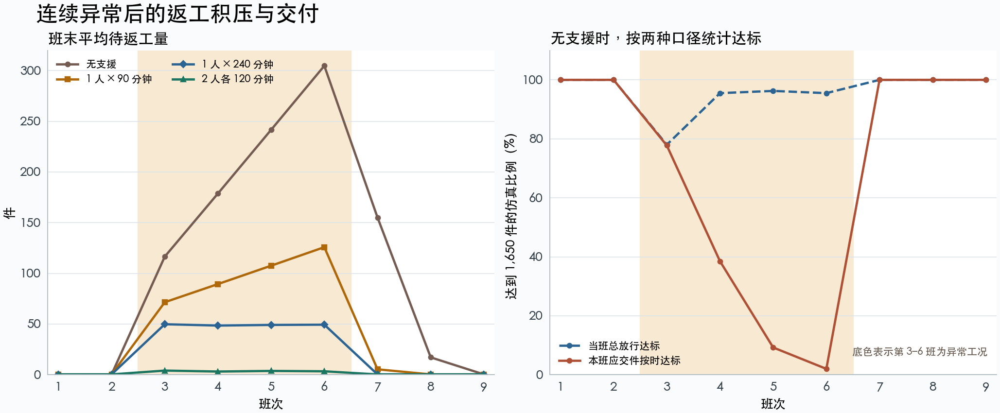

# 跨班返工积压与交付恢复

班末未返工完的工件带到下一班后，次班放行量可能包含大量旧件。这个实验把每件工件归到其**装配完工所在班次**，比较连续四班出现集中不良时，返工积压如何变化，以及质量恢复后需要几班才能清完旧件。每班合格交付目标为 1,650 件。

## 比较条件

- 沿用 Mitchell 的 8 个装配工位、7 个缓冲位、加快装配方案及 420 分钟净班长。每条轨迹经历 2 个正常班、4 个异常班和 3 个恢复班。正常和恢复班的设定首检不合格率为 4%，异常班为 18%。异常班保留每班质量去向总数，按无跨班积压时预计的首检时点，尽量将 65% 的不良排在第 285 至 405 分钟。实际首检时点允许因积压顺延。各方案共用每班的装配完工时点和质量去向。 [公开工序基准](https://assembly-line-balancing.de/salbp/benchmark-data-sets-1993/) · [单班返工支援](REWORK_SUPPORT.md)
- 装配每日重新开线。已完工但未首检、未返工或正在处理的工件保留在下游，按先到先做。把净工作时间拼接，常驻人员在跨班时继续原件剩余加工。检验及返工区设充足暂存，积压不向装配回传。真实班间休息、交接损耗和借出部门代价未计入。
- 异常班预先安排无支援、1 人支援 90 分钟、1 人支援 240 分钟或 2 人各支援 120 分钟。支援都在班末结束，只有能在窗口结束前处理完的件才派给借调人员。两项 240 人分钟方案的区别在于支援人数和开始时点。条件与方案预先设定，用同一批 400 条独立轨迹配对比较。

## 第四个异常班

| 支援配置 | 班末平均待返工件数 | 实际放行达标 | 本班来源按时达标 | 恢复首班清完旧件 |
| --- | ---: | ---: | ---: | ---: |
| 无支援 | 304.70 | 382/400 | 8/400 | 2/400 |
| 1 人 × 90 分钟 | 125.84 | 397/400 | 282/400 | 396/400 |
| 1 人 × 240 分钟 | 49.40 | 397/400 | 386/400 | 400/400 |
| 2 人 × 120 分钟 | **3.42** | 397/400 | **396/400** | 400/400 |



- **交付归属。** 无支援时，第四个异常班有 374 条轨迹的实际放行量达到目标，但该班装配完工且按时放行的数量低于目标。次班补放行的合格件计入实际放行，逾期件仍归原班。恰好在班末放行计为按时。
- **连续积压。** 从首个异常班末到第四个异常班末，无支援和 90 分钟支援的待返工平均每班增加 62.72 件和 18.10 件。两种安排下，本班来源按时达标的轨迹数也持续下降。
- **同用工比较。** 两人各支援 120 分钟相对一人支援 240 分钟，第四个异常班末平均少积压 **45.98 件**，按轨迹配对的 95% 区间为 45.16–46.80 件。两者每异常班都预留 240 人分钟，平均实际返工作业分别为 228.24 和 169.34 人分钟。达标次数按各方案的样本观测报告。
- **恢复时点。** 旧件指异常期结束前已装配完工且尚未放行或报废的工件。到第二个恢复班末，四个方案均在 400 条轨迹上清完旧件，新工件产生的未闭环工作另计。现场可分开记录逾期补交、当班按时交付和剩余返工量。

此次比较使用公开工序与设定质量情景。借调排班适用于能提前识别异常期、并按给定人数和时点到岗的条件。

```bash
python manufacturing/test_rework_carryover.py
python manufacturing/rework_carryover.py
python manufacturing/plot_rework_carryover.py --font /path/to/chinese-font.ttf
```

[参数与汇总](results/rework_carryover.json) · [按轨迹、班次和方案的明细](results/rework_carryover_histories.csv)
